<div align="center">


# 잘타슈 JalTaShu

### 지금 남은 자전거에서, 도착할 때 탈 자전거까지

대전 공공자전거의 현재 현황과 도착 시점의 예상 잔여 수를 확인하고,<br />
일반 경로와 오르막이 적은 경로를 비교하는 서비스입니다.

**삼성청년SW·AI아카데미(SSAFY) 15기 특화 프로젝트 — 우수 프로젝트 선정**

<p>
  
  
  
  
  
  
  
  
</p>

[프로젝트 소개](#프로젝트-소개) · [서비스 화면](#서비스-화면) · [시스템 설계](#시스템-설계) · [팀과 개인 기여](#팀과-개인-기여) · [개발 안내](#개발-안내)

</div>

---

## 프로젝트 소개

대여소에 지금 자전거가 있어도, 걸어서 도착했을 때는 없을 수 있습니다. 가까운 길을 골라도 오르막이 많으면 자전거로 이동하기 부담스럽습니다.

**잘타슈**는 대여소의 현재 정보와 시점별 예상 잔여 수를 함께 보여주고, 이동 시간과 고도를 비교해 경로를 고를 수 있게 만든 서비스입니다. 사용자는 모바일에서 대여소 탐색부터 길 안내, 이동 기록, 고장 제보까지 이용하고, 관리자는 별도 웹에서 이용 현황과 제보 처리 상태를 확인합니다.

| 구분 | 내용 |
| --- | --- |
| 개발 기간 | 2026.08.18–2026.09.28 |
| 팀 구성 | 6명 — Frontend 및 AI 2명, Backend 2명, Data 1명, Infrastructure 1명 |
| 클라이언트 | 모바일 웹/PWA, Capacitor 기반 Android 앱, 관리자 웹 |
| 개인 역할 | 장대산 — **Infrastructure** |
| 팀 수상 | 삼성청년SW·AI아카데미 특화 프로젝트 우수 프로젝트 선정 (2026.09) |

### 사용자 흐름

**목적지 검색 → 대여소와 예상 잔여 수 확인 → 경로 비교 → 길 안내 → 이동 기록 및 제보**

아래 기능은 **팀이 함께 만든 서비스 전체**를 소개합니다. 장대산이 직접 담당한 실행 환경과 배포 작업은 [팀과 개인 기여](#팀과-개인-기여)에서 구분합니다.

## 서비스 화면

### 1. 현재 현황과 도착 시점의 예측을 함께 확인

지도에서 대여소별 현재 자전거 수를 확인하고, 시간대를 바꿔 예상 잔여 수를 조회합니다. 목적지를 선택하면 도착 시점의 예측을 경로 선택과 함께 볼 수 있습니다.

| 대여소 탐색 | 시점별 잔여 수 예측 | 경로 비교 시연 |
| :---: | :---: | :---: |
| 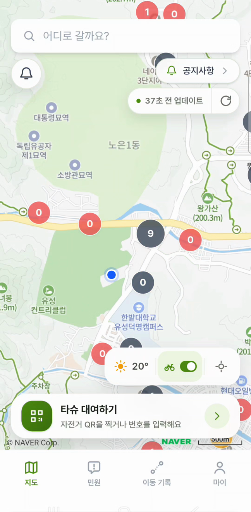 | 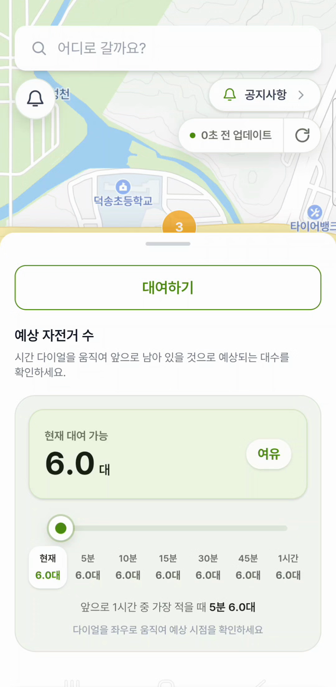 | 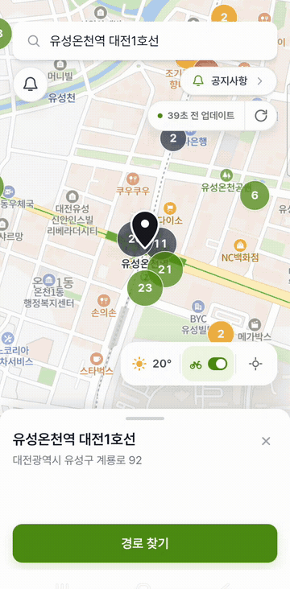 |

### 2. 경로의 고도를 비교하고, 이용 후 기록과 제보를 남김

일반 경로와 오르막이 적은 경로의 시간, 거리, 고도를 비교합니다. 선택한 경로는 주행 안내로 이어지며, 이용 후에는 이동 기록을 확인하거나 사진을 첨부해 자전거 문제를 제보할 수 있습니다.

| 경로별 고도와 안내 | 사진 첨부 고장 제보 | 이동 기록 |
| :---: | :---: | :---: |
| 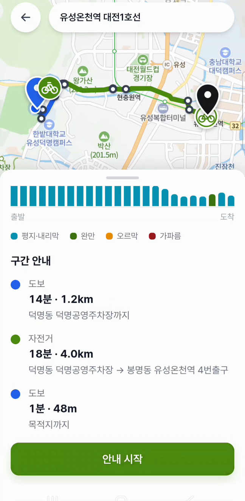 | 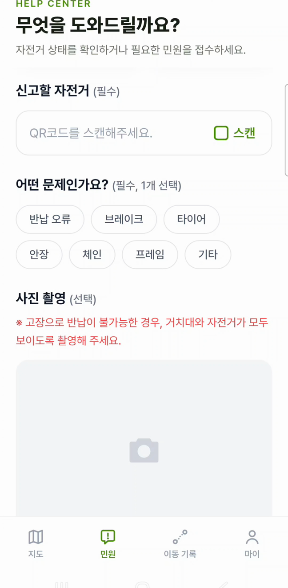 | 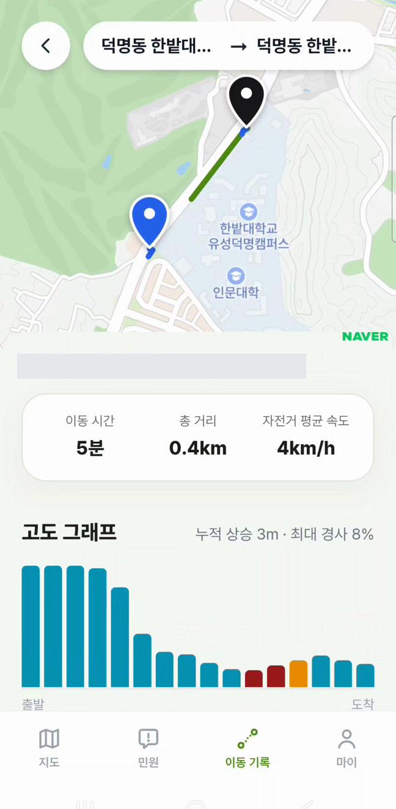 |

<details>
<summary><b>정지 화면으로 경로 비교 자세히 보기</b></summary>

<p align="center">
  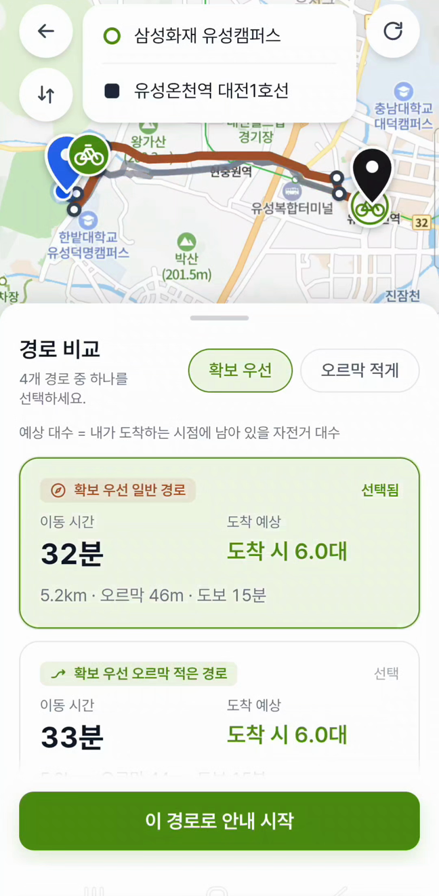
</p>

</details>

### 3. 관리자 웹에서 대여소 현황과 제보 처리

관리자는 지도와 시간대별 흐름으로 대여소 이용 현황을 확인합니다. 사용자 이용 제한, 자전거별 기록 조회, 제보 처리 상태 변경과 공지 관리 기능도 제공합니다.

**대여소 이용 현황 — 지도 및 시간대 변경 시연**

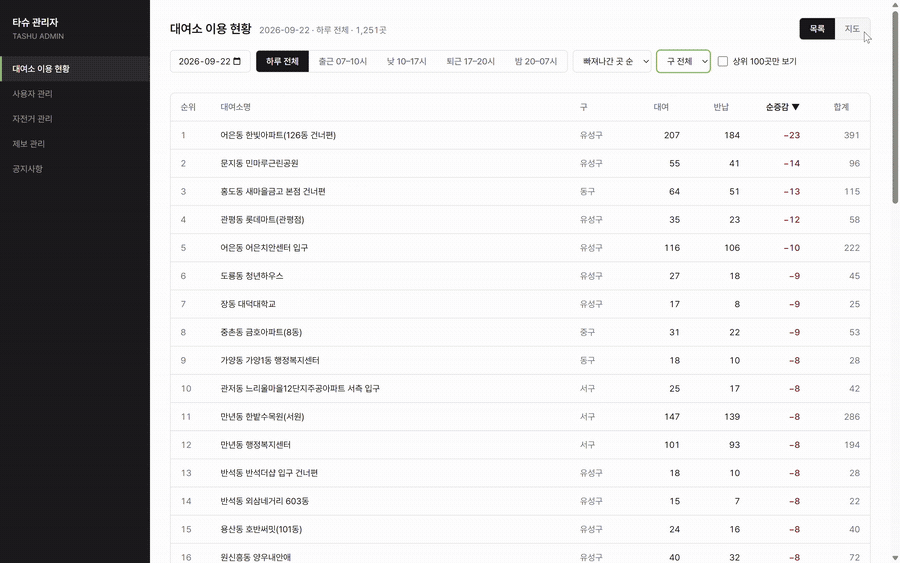

<details>
<summary><b>제보 상세 및 처리 상태 변경 화면</b></summary>

<p align="center">
  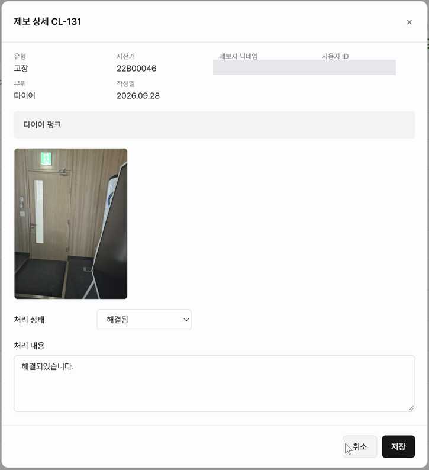
</p>

</details>

> 실제 사용자·관리자 시연 영상에서 추출한 화면과 GIF입니다. 화면의 수치와 기록은 시연 당시 표시된 값이며, 현재 서비스 상태나 예측 정확도 지표를 뜻하지 않습니다. 사용자 식별 정보는 사본에서 가렸습니다.

---

## 시스템 설계

### 서비스와 데이터 처리, 배포 환경의 역할 분리

<a href="docs/readme-assets/architecture.svg">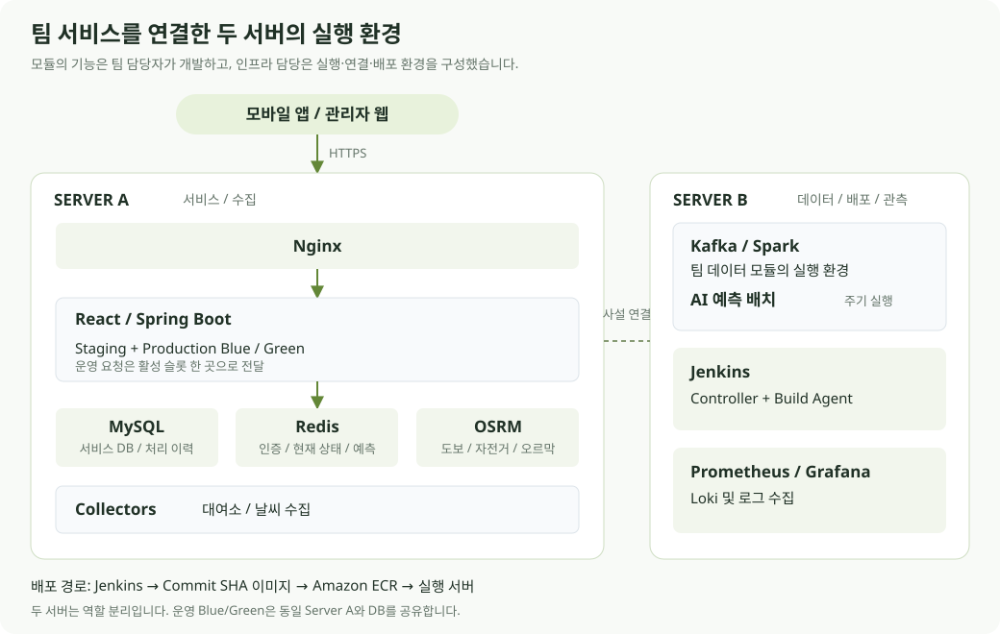</a>

- **Server A**: Nginx, Frontend 및 Backend, MySQL, Redis, Collector와 OSRM을 실행합니다.
- **Server B**: Kafka, Spark, AI 예측 배치, Jenkins와 모니터링 도구를 실행합니다.
- AI 예측 배치는 MySQL 이력을 읽어 Redis에 결과를 저장하고, Backend가 해당 결과를 조회합니다. 오르막이 적은 경로는 **OSRM과 고도 데이터**를 사용하는 별도 경로 계산입니다.

두 서버는 **역할을 나눈 구성**이며 서비스 이중화가 아닙니다. Blue/Green은 Server A 한 대 안의 배포 슬롯이고 운영 DB를 공유하므로, 이미지 롤백으로 DB 변경까지 되돌리지는 않습니다.

<details>
<summary><b>수집부터 앱 조회까지의 데이터 흐름</b></summary>

<br />

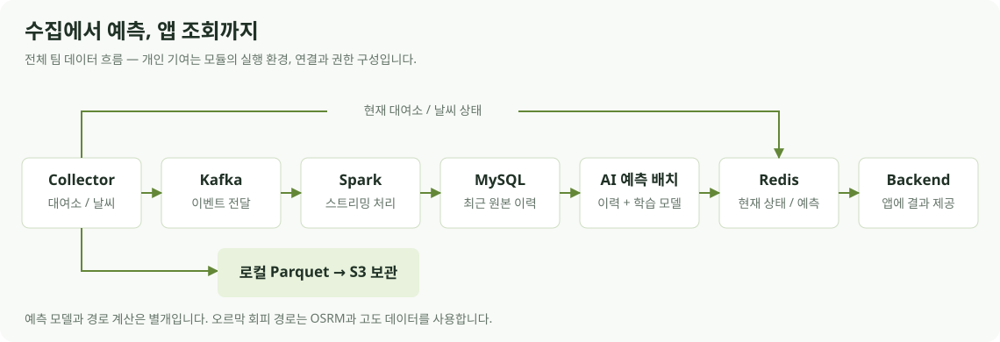

Collector의 로컬 Parquet을 S3에 보관하는 경로와 Kafka를 통한 실시간 처리 경로를 분리했습니다. Kafka는 단일 브로커 구성입니다. 데이터 수집·변환 로직과 모델 학습·예측은 각 팀 담당자가 구현했고, 장대산은 이 모듈들이 실행되고 서로 연결되는 환경을 구성했습니다.

</details>

### 프로젝트 전체 기술

| 영역 | 사용 기술 |
| --- | --- |
| Backend | Java, Spring Boot, Spring Data JPA, Spring Security |
| Frontend 및 Mobile | React, TypeScript, Vite, Capacitor, Naver Maps |
| Data 및 AI | Python, Kafka, Spark Structured Streaming, Parquet, LightGBM |
| Database 및 Cache | MySQL, Redis |
| Routing | OSRM, DEM 고도 데이터 |
| Infrastructure 및 CI/CD | AWS EC2, ECR, S3, IAM, Docker, Docker Compose, Nginx, Jenkins, JCasC, systemd |
| Observability | Prometheus, Grafana, Loki, Alloy, node_exporter |

팀 전체 기술 목록입니다. 개인이 직접 작성한 애플리케이션이나 모델의 범위와는 구분합니다.

---

## 팀과 개인 기여

### 팀 역할

| 담당 | 인원 | 주요 범위 |
| --- | ---: | --- |
| Frontend 및 AI | 2명 | 모바일 및 관리자 화면, AI 모델과 예측 기능 |
| Backend | 2명 | 사용자, 대여소, 경로, 이용 기록, 제보 및 관리자 API |
| Data | 1명 | 데이터 수집과 변환, 스트리밍 처리 로직 |
| **Infrastructure — 장대산** | **1명** | **서버, 실행 환경, 서비스 연결, CI/CD, 관측 및 백업·복원** |

### 장대산 / Infrastructure

팀원이 개발한 서비스와 데이터 처리 모듈을 두 EC2에 배치하고, **Docker 실행 환경, 네트워크 연결, 접근 권한과 배포 절차**를 구성했습니다.

| 영역 | 직접 수행한 작업 |
| --- | --- |
| 실행 환경과 연결 | 두 EC2에 서비스와 데이터 처리 환경 배치, MySQL 및 Redis 연결과 권한 구성, OSRM 실행 환경 연결 |
| 데이터 및 AI 모듈 실행 | 팀의 Collector, Kafka, Spark 작업과 AI 예측 컨테이너가 실행·연결되도록 설정, 모델 파일 읽기 전용 마운트 |
| 배포 | Jenkins 테스트와 Docker 빌드, Commit SHA 태그의 ECR 업로드, Staging 자동 배포 및 Production 승인형 Blue/Green |
| 설정 재현 | Docker Secret과 JCasC를 연결해 Jenkins 자격증명 복구, 필수값 누락 시 시작 차단 |
| 관측과 복구 | Prometheus, Grafana, Loki 연결, MySQL 백업과 S3 보관, 격리 MySQL 복원 확인 |

### 주요 문제 해결과 검증

#### 승인 취소 뒤 남은 배포 후보 정리

승인 대기 중 배포를 취소하면 비활성 슬롯의 후보 컨테이너와 상태 파일이 남는 문제가 있었습니다. Jenkins 후처리에 정리를 연결하고, **후보 SHA 일치와 활성 슬롯 여부를 검사**해 다른 배포나 운영 슬롯을 삭제하지 않도록 했습니다. 후처리 SSH 계정 오류를 수정한 뒤 실제 승인 취소 경로에서 후보 제거, 활성 슬롯 유지와 서비스 응답을 확인했습니다.

#### Jenkins 재시작 후 GitLab 자격증명 소실

Controller를 재시작한 뒤 Job과 빌드 기록은 남았지만, UI로 등록한 GitLab 자격증명이 사라져 저장소 인증이 실패했습니다. 실제 비밀값은 **Docker Secret**, 자격증명 정의는 **JCasC**로 관리하도록 수정했습니다. 서버 재시작 후 자격증명과 Job, Agent 유지 및 Polling 자동 빌드 성공을 확인했습니다.

#### 백업 파일 검사에서 격리 복원 확인까지

MySQL 백업에 중복 실행 lock, 임시 파일, gzip 검사와 checksum을 적용하고 S3 보관을 연결했습니다. S3에서 다시 받은 백업의 checksum 일치와, **외부 네트워크 및 영구 볼륨이 없는 MySQL에서 SQL import와 두 스키마 복원**을 확인했습니다.

<details>
<summary><b>검증 범위</b></summary>

- 승인 취소의 실제 재검증은 당시 실행 기록에 근거합니다. SHA 및 활성 슬롯 보호는 구현된 조건이며, 모든 실패 경로의 무중단 운영을 입증한 것은 아닙니다.
- Jenkins 결과는 당시 서버 재시작과 Polling 기록입니다.
- 위 백업 결과는 당시 checksum, SQL import와 스키마 확인 범위입니다. 운영 데이터 전체의 행 단위 무손실 복구나 RTO/RPO 달성을 주장하지 않습니다.

</details>

---

## 개발 안내

### 저장소 구조

```text
backend/good-tashu/  Spring Boot API
frontend/           모바일 웹, 관리자 웹 및 Android 프로젝트
data-pipeline/      대여소·날씨 수집과 스트리밍 처리
tashu-ai/           모델 학습과 주기적 예측 배치
osrm/               도보·자전거·오르막 회피 경로 엔진
infra/              실행 환경, Jenkins, 관측, DB 및 백업 설정
docs/               데이터 계약과 AI 설계 문서
exec/               빌드·배포 안내와 시연 시나리오
```

<details>
<summary><b>Frontend 로컬 개발</b></summary>

Node.js 22 환경을 기준으로 합니다. 저장소 루트에서 실행합니다.

```bash
cd frontend
npm ci
# .env.example을 .env.local로 복사하고 필요한 개발 설정 입력
npm run dev
```

Backend 없이 화면을 개발하려면 예제 설정의 `VITE_ENABLE_MSW=true`를 사용합니다. 실제 지도와 외부 API 연동에는 별도 설정이 필요합니다.

```bash
npm test
npm run lint
npm run build
```

</details>

<details>
<summary><b>Backend 및 전체 환경 안내</b></summary>

JDK 21을 사용합니다. Windows에서는 `gradlew.bat`를 사용합니다.

```bash
cd backend/good-tashu
./gradlew test
```

서비스 실행에는 MySQL, Redis와 환경 설정이 필요하며 데이터·AI 모듈에는 외부 API, 모델 파일 및 경로 데이터가 추가로 필요합니다. 설정과 모듈별 실행 안내는 저장소의 다음 문서에 정리돼 있습니다.

| 문서 | 내용 |
| --- | --- |
| `exec/01-launching.md` | 빌드, 배포와 앱 실행 |
| `exec/04. 시연시나리오.md` | 사용자 및 관리자 시연 순서 |
| `infra/runtime/production/README.md` | 승인형 Blue/Green 배포 |
| `infra/jenkins/README.md` | Controller, Agent와 자격증명 |
| `infra/mysql/BACKUP.md` | 백업과 격리 복원 |
| `infra/redis/README.md` | DB 번호와 서비스별 연결 계약 |
| `data-pipeline/streaming/README.md` | Kafka에서 MySQL까지의 처리 |
| `tashu-ai/README.md` | 모델과 예측 배치 실행 |

</details>

---

<p align="center"><b>도착할 때 탈 수 있도록 — 잘타슈</b></p>
